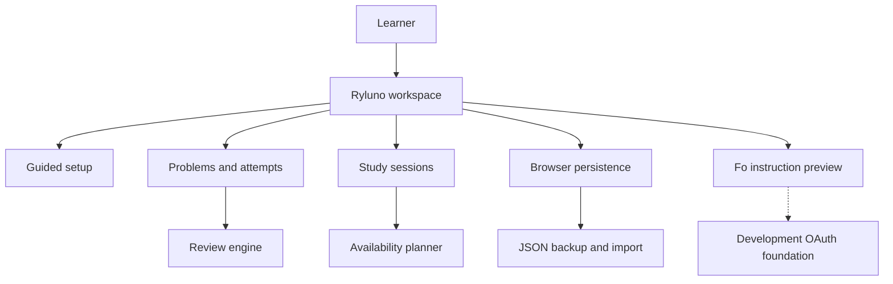

# Ryluno

A technical interview preparation companion with explainable reviews, availability-based study planning, and an in-development Fo accountability integration.

Ryluno makes room for steady progress: log a problem, reflect on how it went, and find the next small step. The workspace combines a problem journal, adaptive reviews, and a study schedule that fits your availability.

## Current functionality

- Track problems, topics, attempts, confidence, and notes.
- Get explainable review recommendations based on outcomes and confidence.
- Plan study sessions around your timezone, weekly availability, and interview date.
- Complete, skip, or reschedule sessions and review your progress.
- Use guided onboarding, browser-local persistence, and JSON backup/import.
- Preview text-only Fo accountability instructions for a selected session.

### Fo integration status

Fo is not yet a live accountability service in Ryluno. The website OAuth foundation is intended for authenticated localhost development, but live website authorization and Fo tool schemas still need verification.

- **Available:** text-only accountability instruction previews.
- **Not yet verified:** live website authorization and Fo tool schemas.
- **Disabled:** check-in submission and reply retrieval.
- **Not enabled:** phone calls.

See [Fo integration setup and limitations](docs/fo-integration.md).

## Run locally

```sh
npm install
npm run dev
```

Open `http://localhost:3000`.

Fo development setup uses that exact origin and requires additional local configuration described in the [integration guide](docs/fo-integration.md).

## Validation

Run the project's checks locally:

```sh
npx tsc --noEmit
npm run lint
npm test
npm run build
```

These commands are validation steps, not a claim that every check currently passes.

Tests use Node's built-in test runner with TypeScript stripping and the `react-server` condition for server-only integration modules.

## Implementation

Built with Next.js App Router, TypeScript, React, Tailwind CSS, Recharts, date-fns, Lucide icons, and the official MCP TypeScript client.

### Architecture overview

The diagram summarizes the responsibilities listed below; it does not imply that live Fo check-ins are enabled.



| Area | Source |
| :--- | :--- |
| Workspace and navigation | [Ryluno component](src/components/ryluno.tsx) |
| Guided setup | [Onboarding](src/components/onboarding.tsx) |
| Adaptive reviews | [Review engine](src/lib/review.ts) |
| Availability scheduling | [Planner](src/lib/planner.ts) |
| Browser persistence and backup validation | [Storage](src/lib/storage.ts) |
| Fo connection interface | [Fo panel](src/components/fo-panel.tsx) |
| Server-only Fo integration | [Fo modules](src/lib/fo/) |
| Automated checks | [Tests](tests/) |

## Existing data compatibility

Ryluno was formerly named AlgoPilot. The browser storage key **`algopilot.v1`** is intentionally retained so existing problems, attempts, sessions, settings, and onboarding behavior continue to work without migration.

The persisted version remains `1`, and field names and validation rules are unchanged.

Existing AlgoPilot JSON backups still import normally; their filenames do not affect validation.

| Export type | Filename |
| :--- | :--- |
| New backup | `ryluno-backup.json` |
| Recovery export | `ryluno-recovery.json` |

Browser data remains tied to the same browser and origin—scheme, host, and port. Keep using the same address to access your saved workspace.

The rebrand does not move data, change the project folder or Git remote, or alter Fo authorization and callback behavior.
